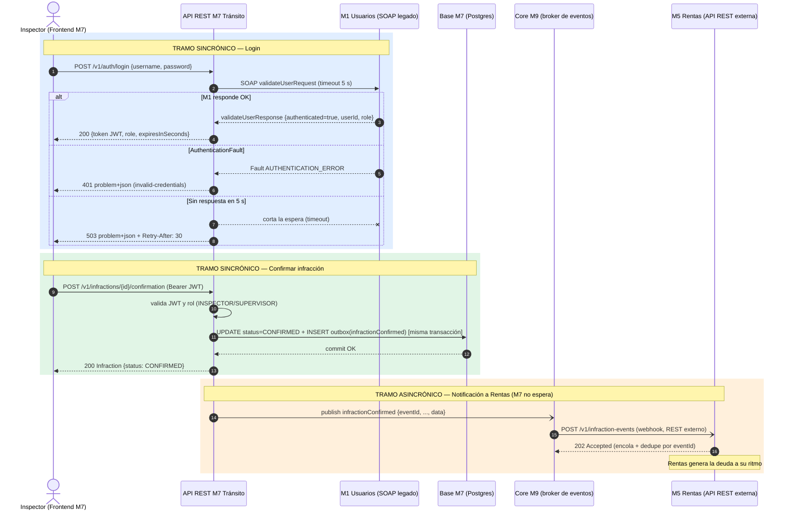

# Actividad Integradora — "La API REST de su dominio" · Módulo 7 Tránsito

> **Para:** dev backend (y para pegar en Claude)
> **De:** QA (Alejo)
> **Fecha:** 06-10-2026
> **Fuentes:**
> - Consigna y teoría: *Clase10_UnidadVI_ServiciosREST.pdf* (diapos 31-34 para la actividad; 8-25 para las buenas prácticas que se aplican acá).
> - Diseño de la Clase 9: *TPO - Desarrollo de Apps II*, Grupo 9.
> - Código del backend: zip del 22-09.
>
> **Archivos que acompañan este documento:**
> - `openapi.yaml`: contrato OpenAPI 3.0 ya escrito y **validado** con `openapi-spec-validator`.
> - Este `.md`: análisis, tareas, diagramas y decisiones.
>
> ⚠️ **Antes de tocar código, leé la sección 9 ("Cómo usar este documento con Claude").** Hay decisiones de diseño que **tienen que confirmar ustedes**; no se aplican a ciegas.

---

## 0. TL;DR

La consigna pide entregar 5 cosas.

| # | Entregable | ¿Qué tenemos hoy? | Estado | ¿Qué falta? |
|---|---|---|---|---|
| 1 | Catálogo de ≥ 6 endpoints (método, URI, request, respuestas, códigos) | 30 endpoints implementados + `docs/guia-integracion-frontend.md` | 🟢 Casi | Armarlo en formato tabla con `/v1` y todos los códigos → **ya está en la §3** |
| 2 | Contrato OpenAPI (YAML, ≥ 2 endpoints, uno con error) | Nada (sin springdoc, sin YAML) | 🟢 **Resuelto en papel** | `openapi.yaml` adjunto (10 operaciones, errores en Problem Details). En código: conectar Swagger (§6.1) |
| 3 | Ejemplos JSON: un request/response exitoso + un error en **Problem Details** | Ejemplos con formato propio `ErrorResponse {timestamp,status,error,message}` | 🟡 | Migrar errores a **RFC 9457 Problem Details** (§6.3). Los ejemplos ya están en la §4 |
| 4 | Diagrama de secuencia REST propia → SOAP legado → evento → REST externo, con tramos sync/async | El diseño de la Clase 9 (login SOAP con M1 + `infractionConfirmed` a M5), pero sin diagrama de secuencia | 🟡 | Diagrama ya hecho en la §5 (Mermaid). En código **no existe el cliente SOAP** ni broker |
| 5 | Decisiones: idempotencia, versionado, seguridad, qué pasa si el SOAP no contesta en 5 s | Seguridad JWT por roles ✅. Sin versionado, sin idempotencia, sin cliente SOAP | 🔴 | Decisiones redactadas en la §7. Implementación en la §6 |

**Pregunta clave de la consigna: "si el SOAP legado no responde en 5 s, ¿qué devuelve su API?"**
> **`503 Service Unavailable`** en Problem Details, con header `Retry-After: 30`. **No** se emite el token y el usuario puede reintentar. Esto coincide con lo que definimos en la Clase 9: "se informa que el servicio de autenticación se encuentra temporalmente no disponible". Justificación en la §7.4.

**Cómo nos evalúan (diapo 34) y dónde lo cubrimos:**

| Criterio | Peso | Dónde |
|---|---|---|
| Diseño orientado a recursos (URIs y métodos) | 25 % | §3 (URIs con sustantivos, sub-recursos), §6.8 |
| Uso correcto de HTTP: códigos, headers, idempotencia | 25 % | §3, §4, §6.5, §7.1 (`Location`, `Retry-After`, `Idempotency-Key`, 201/409/429/503) |
| Contrato y errores: OpenAPI + Problem Details | 20 % | `openapi.yaml`, §4.3-4.5, §6.1, §6.3 |
| Integración de punta a punta con las Clases 8 y 9 | 20 % | §1, §5 (SOAP M1 → evento → webhook REST de Rentas) |
| Claridad de la presentación | 10 % | §5 + §7 |

**Extras que suman en la defensa:** nivel 3 de Richardson (HATEOAS) en `GET /v1/infractions/{id}`, paginación con `_links` y rate limiting (429) en el login.

**¿Qué tan lejos estamos?**
- **Para entregar el documento** (los 5 puntos): **cerca**. Todo el contenido está en este `.md` y en `openapi.yaml`; falta pasarlo al formato de entrega del Teams.
- **Para que el código lo cumpla de punta a punta:** faltan ~6 tareas, la más grande es el cliente SOAP (§6). Ninguna es enorme.

---

## 1. Contexto: qué definimos en la Clase 9

Del documento *TPO - Desarrollo de Apps II*, Grupo 9:

| Escenario | Tipo | Productor → Consumidor | Contrato |
|---|---|---|---|
| **Validación de datos para login** | **Sincrónico (SOAP)** | M7 Tránsito → **M1 Usuarios** | Operación `validateUser(username, password)` → `{authenticated, userId, role}`. Fault: `AuthenticationFault {code: AUTHENTICATION_ERROR, message}` |
| **Confirmación de infracción a Rentas** | **Asincrónico (evento)** | M7 Tránsito → **M5 Rentas** | Evento `infractionConfirmed`, sobre `{eventId, eventType, occurredAt, sourceModule, data}` |
| **Timeout SOAP** | — | — | Máximo **5 s**. Si M1 no responde: no se completa la autenticación, no se permite el ingreso, se informa "servicio temporalmente no disponible" y se puede reintentar |

Aclaración del propio documento: *"la integración SOAP con M1 se plantea como una propuesta a incorporar; `infractionConfirmed` ya forma parte del esquema de eventos"*.

### Cómo encaja con el código actual

| Pieza | En el código hoy | Archivo |
|---|---|---|
| Login | `POST /auth/login` valida contra un **stub en memoria** con 7 usuarios. El comentario dice textualmente "hay que reemplazar por un cliente REST al módulo de Usuarios" | `auth/StubIdentityValidator.java:10` |
| Punto de extensión para M1 | ✅ Interfaz `IdentityValidator.validate(username, password)`. **Solo hay que agregar una implementación SOAP**, el resto del login no cambia | `auth/IdentityValidator.java` |
| `infractionConfirmed` | ✅ Se publica al confirmar, con el payload completo (validado por QA en TC-BE-INF-16/17/18) | `service/InfractionService.java:100-125` |
| Envío al broker | ⚠️ `LoggingEventPublisher` solo escribe en el log: no hay broker real (depende de Core, M9) | `event/LoggingEventPublisher.java` |
| Errores | ⚠️ Formato propio `ErrorResponse`, no Problem Details | `web/GlobalExceptionHandler.java` |
| Swagger / OpenAPI | ❌ No existe | — |
| Versionado | ❌ No hay `/v1` | — |

> 💬 *"En su momento algo habíamos hecho con Swagger"*: en el zip del 22-09 **no hay nada** (ni `springdoc` en el `pom.xml` ni configuración). Si existe, está en otra rama de GitHub. Para buscarlo:
> ```bash
> git log --all --oneline -S springdoc
> git grep -i -E "springdoc|swagger|openapi" $(git rev-list --all) | head
> ```
> Si aparece, reutilícenlo. Si no, la §6.1 tiene la receta **ya probada** con nuestro proyecto.

---

## 2. Brechas detectadas (lo que el código tiene que cambiar)

| ID | Brecha | Afecta entregable | Prioridad | Sección |
|---|---|---|---|---|
| GAP-01 | No hay Swagger / OpenAPI generado desde el código | 2 | Alta | §6.1 |
| GAP-02 | No hay versionado (`/v1`) | 5 | Alta | §6.2 |
| GAP-03 | Errores con formato propio, no Problem Details (RFC 9457) | 3 | Alta | §6.3 |
| GAP-04 | No hay cliente SOAP a M1 `validateUser` ni timeout de 5 s | 4, 5 | **Alta (la más grande)** | §6.4 |
| GAP-05 | No hay idempotencia en `POST` de creación ni deduplicación de eventos | 5 | Media | §6.5 |
| GAP-06 | El evento se publica antes del commit; no hay broker real | 4 | Media (depende de Core) | §6.6 |
| GAP-07 | Seguridad: `inspectorId` y `authorizedBy` vienen del body (BUG-BE-05/07 del informe de QA); 401 vs 403 | 5 | Media | §6.7 |
| GAP-09 | URIs con **verbos** (`/confirm`, `/annul`, `/approve`...). La diapo 14 pide sustantivos y acciones como sub-recurso | 1 (25 % de la nota) | Alta | §6.8 |
| GAP-10 | Sin hipermedia (nivel 2 de Richardson). La diapo 18: "nivel 3 en un recurso suma en la defensa" | 1 | Media | §6.9 |
| GAP-11 | Fechas sin zona horaria (`LocalDateTime` → `2026-09-20T10:15:00`). La diapo 13 pide ISO 8601 **con zona** | 3 | Media | §6.10 |
| GAP-12 | Colecciones sin filtros, orden ni paginación (diapo 15) | 1 | Media | §6.11 |
| GAP-13 | Sin rate limiting (429) en el login (diapo 25) | 5 | Baja | §6.12 |
| GAP-14 | `POST` de creación devuelve 201 **sin header `Location`** (diapos 8 y 22) | 1 | Baja | §6.13 |
| GAP-08 | La respuesta SOAP de M1 **no trae `nationalId`**, pero el JWT actual lo usa para `/infractions/mine` | 4 | **Bloqueante para CIUDADANO** | §8 (pregunta abierta) |

---

## 3. Entregable 1 — Catálogo de endpoints

> URIs con `/v1` (contrato objetivo). Hoy en el código las URIs son las mismas sin `/v1`.
> Todos los errores se devuelven en `application/problem+json` (ver §4.3).
> 🔒 = requiere `Authorization: Bearer <JWT>`.

| # | Método | URI | Rol | Request | Respuesta OK | Códigos posibles |
|---|---|---|---|---|---|---|
| 1 | `POST` | `/v1/auth/login` | Público | `{username, password}` | `200 {token, role, expiresInSeconds}` | 200 · 400 body inválido · **401** credenciales inválidas (Fault de M1) · **429** demasiados intentos · **502** error inesperado de M1 · **503** M1 no respondió en 5 s |
| 2 | `POST` 🔒 | `/v1/infractions` | INSPECTOR | `CreateInfractionRequest` + header opcional `Idempotency-Key` | `201` + `Location` + `Infraction` (`PENDING_APPEAL`) | 201 · 200 reintento idempotente · 400 · 401 · 403 · 422 misma key con otro body |
| 3 | `GET` 🔒 | `/v1/infractions?status=&licensePlate=&from=&to=&sort=-infractionDateTime&page=1&size=20` | INSPECTOR, SUPERVISOR, AUDITOR | — | `200 {data[], page{number,size,totalElements}, _links{self,prev,next}}` | 200 · 400 filtro inválido · 401 · 403 |
| 4 | `GET` 🔒 | `/v1/infractions/mine` | CIUDADANO | — | `200 Infraction[]` | 200 · 401 · 403 |
| 5 | `GET` 🔒 | `/v1/infractions/{id}` | INSPECTOR, AUDITOR, CIUDADANO (propia) | — | `200 Infraction` + **`_links`** con las acciones posibles según estado y rol (HATEOAS) | 200 · 400 id inválido · 401 · 403 · 404 |
| 6 | `POST` 🔒 | `/v1/infractions/{id}/appeal` | CIUDADANO titular | `{reason}` | `200 Infraction` (`APPEALED`) | 200 · 401 · 403 · 404 · 409 |
| 7 | `POST` 🔒 | `/v1/infractions/{id}/confirmation` | INSPECTOR, SUPERVISOR | — | `200 Infraction` (`CONFIRMED`) + **evento async `infractionConfirmed` → M5** | 200 · 401 · 403 · 404 · 409 |
| 8 | `POST` 🔒 | `/v1/infractions/{id}/annulment` | SUPERVISOR | `{annulmentReason}` | `200 Infraction` (`ANNULLED`) + evento `infractionAnulled` | 200 · 400 · 401 · 403 · 404 · 409 |
| 9 | `POST` 🔒 | `/v1/impoundments/{id}/release` | PERSONAL_DEPOSITO | `{verifiedRequirements[], towingAndStorageFee, paymentReference}` | `200 VehicleImpoundment` (`RELEASED`) + evento `vehicleReleased` | 200 · 400 · 401 · 403 · 404 · 409 |
| 10 | `GET` | `/v1/parking-zones` | Público | — | `200 ParkingZone[]` | 200 |

> **Convenciones aplicadas (diapos 13-15):**
> - Sustantivos en plural, minúsculas con guiones (`/parking-zones`).
> - Las acciones de negocio son **sub-recursos con sustantivo** (`/confirmation`, `/appeal`, `/annulment`, `/release`), nunca verbos.
> - Fechas ISO 8601 con zona (`2026-08-24T13:45:00-03:00`), camelCase, enums como strings y montos decimales.
> - Se exponen DTOs, nunca entidades JPA.

**Resto de la API implementada** (no hace falta para el mínimo de 6, pero existe): `/parking-tariffs`, `/parking-sessions` (+ `/close`, `/flag-unpaid`), `/accidents`, `/operations` (+ `/close`), `/street-closures` (+ `/approve`, `/reject`, `/activate`, `/finish`), `/impoundments`. Detalle en `docs/guia-integracion-frontend.md` y en Swagger una vez conectado.

**Diferencias entre el código actual y este catálogo** (lo que hay que cambiar para que coincidan):
- Renombres de URIs (§6.8):
  - `/confirm` → `/confirmation`
  - `/annul` → `/annulment`
  - En cortes: `/approve` → `/approval`, `/reject` → `/rejection`, `/activate` → `/activation`, `/finish` → `/completion`
  - En operativos y sesiones: `/close` → `/closure`
  - `/flag-unpaid` → `/unpaid-flag`
- Paginación en `GET /v1/infractions` (§6.11), `_links` en el detalle (§6.9), fechas con zona (§6.10) y `Location` en los 201 (§6.13).
- `inspectorId` (en #2) y `authorizedBy` (en #8) **salen del JWT**, no del body.
- #2 exige `evidenceUrl` con al menos 1 elemento (regla del TP).
- #9 exige requisitos y pago.
- Sin token → **401** (hoy devuelve 403). Ver la decisión en la §7.3.

---

## 4. Entregable 3 — Ejemplos JSON

### 4.1 Éxito — Confirmar infracción (dispara el evento a Rentas)

**Request**
```http
POST /v1/infractions/93fd4382-2343-4f3f-a127-9328b29fc520/confirmation HTTP/1.1
Host: transito-backend-production-28d6.up.railway.app
Authorization: Bearer <token-jwt>
```

**Response `200 OK`**
```json
{
  "infractionId": "93fd4382-2343-4f3f-a127-9328b29fc520",
  "licensePlate": "AB123CD",
  "infractionType": "ILLEGAL_PARKING",
  "infractionDateTime": "2026-08-24T13:45:00-03:00",
  "location": { "street": "Av. Cabildo", "crossStreet": "Juramento", "latitude": -34.5621, "longitude": -58.4563 },
  "evidenceUrl": ["https://evidencias.uade.edu.ar/inf/foto1.jpg"],
  "inspectorId": "INS-245",
  "offenderNationalId": "40123456",
  "debtorId": "40123456",
  "debtorIdType": "DNI",
  "baseAmount": 50000,
  "aggravatingFactors": ["REINCIDENCE"],
  "finalAmount": 75000,
  "status": "CONFIRMED",
  "_links": {
    "self": { "href": "/v1/infractions/93fd4382-2343-4f3f-a127-9328b29fc520" }
  }
}
```
> Como quedó `CONFIRMED` (acta cerrada), `_links` solo trae `self`. La misma infracción en `PENDING_APPEAL` traería además `appeal`, `confirmation` y `annulment` según el rol (ver §6.9).

**Evento publicado de forma asincrónica** (mismo payload que la Clase 9):
```json
{
  "eventId": "7f9c91f0-03c6-4baf-8791-8cb2c38981d2",
  "eventType": "infractionConfirmed",
  "occurredAt": "2026-08-24T14:30:00-03:00",
  "sourceModule": "transito",
  "data": {
    "infractionId": "93fd4382-2343-4f3f-a127-9328b29fc520",
    "debtorId": "40123456", "debtorIdType": "DNI",
    "licensePlate": "AB123CD", "infractionType": "ILLEGAL_PARKING",
    "infractionDateTime": "2026-08-24T13:45:00-03:00",
    "baseAmount": 50000, "aggravatingFactors": ["REINCIDENCE"], "finalAmount": 75000,
    "inspectorId": "INS-245",
    "location": { "street": "Av. Cabildo", "crossStreet": "Juramento", "latitude": -34.5621, "longitude": -58.4563 }
  }
}
```

### 4.2 Éxito — Login (con M1 respondiendo bien)
```http
POST /v1/auth/login
Content-Type: application/json

{ "username": "inspector1", "password": "********" }
```
```json
200 OK
{ "token": "<token-jwt>", "role": "INSPECTOR", "expiresInSeconds": 7200 }
```

### 4.3 Error en Problem Details — M1 no responde en 5 s (la pregunta clave)
```http
HTTP/1.1 503 Service Unavailable
Content-Type: application/problem+json
Retry-After: 30
```
```json
{
  "type": "https://transito.uade.edu.ar/problems/auth-service-unavailable",
  "title": "Servicio de autenticación no disponible",
  "status": 503,
  "detail": "El servicio de usuarios (M1) no respondió en 5 segundos. Intentá nuevamente en unos minutos.",
  "instance": "/v1/auth/login",
  "upstream": "M1-validateUser",
  "timeoutMs": 5000
}
```

### 4.4 Error en Problem Details — Transición inválida
```json
409 Conflict · Content-Type: application/problem+json
{
  "type": "https://transito.uade.edu.ar/problems/invalid-state-transition",
  "title": "Transición de estado inválida",
  "status": 409,
  "detail": "No se puede confirmar una infracción en estado ANNULLED",
  "instance": "/v1/infractions/93fd4382-2343-4f3f-a127-9328b29fc520/confirmation",
  "currentStatus": "ANNULLED"
}
```

### 4.5 Catálogo de `type` de Problem Details

| `type` (sufijo de `https://transito.uade.edu.ar/problems/`) | status | Cuándo |
|---|---|---|
| `validation-error` | 400 | JSON mal formado, campo obligatorio faltante, enum inválido (incluye `errors[]` por campo) |
| `invalid-credentials` | 401 | M1 devolvió `AuthenticationFault` |
| `unauthenticated` | 401 | Falta el token, o es inválido o está vencido |
| `forbidden` | 403 | El rol no alcanza, o el recurso no es del ciudadano |
| `not-found` | 404 | El id no existe |
| `invalid-state-transition` | 409 | Confirmar una anulada, editar una firme, etc. |
| `too-many-requests` | 429 | Más de 5 intentos de login por minuto desde la misma IP (incluye `Retry-After`) |
| `idempotency-key-reused` | 422 | Misma `Idempotency-Key` con otro body |
| `upstream-error` | 502 | M1 respondió con un Fault o una respuesta no reconocida |
| `auth-service-unavailable` | 503 | M1 no respondió en 5 s |

> Las URIs de `type` son identificadores: no hace falta que la página exista.

---

## 5. Entregable 4 — Diagrama de secuencia

Cadena pedida por la consigna: **API REST propia → SOAP legado → evento → REST externo**. Así la mapeamos con lo definido en la Clase 9:

- **API REST propia** = M7 (`/v1/auth/login` y `/v1/infractions/{id}/confirmation`).
- **SOAP legado** = M1 Usuarios, `validateUser`.
- **Evento** = `infractionConfirmed`, vía el broker de Core (M9).
- **REST externo** = **API REST de M5 Rentas**. El evento le llega como **webhook**: Core hace `POST /v1/infraction-events` a Rentas, que responde `202 Accepted` y procesa por su cola. Es el patrón de la diapo 28 (Mercado Pago): *"un webhook es, en el fondo, mensajería sobre HTTP; responder rápido y encolar"*, y el `202 Accepted` es el puente REST ↔ mensajería de la diapo 11.
  - ⚠️ *Supuesto a confirmar con Core/Rentas:* si Rentas consume directo del broker, el último tramo se dibuja como consumo de cola y el "REST externo" pasa a ser la consulta de estado de la deuda (`GET /v1/debts?infractionId=`).



**Leyenda:**
- `->>` llamada sincrónica (el emisor espera la respuesta).
- `-)` mensaje asincrónico (*fire-and-forget*).
- `--x` corte por timeout.

> Para la entrega en el Teams: pegar el bloque en https://mermaid.live y exportar a PNG.

---

## 6. Qué hay que implementar (tareas para el dev)

> Orden sugerido: 6.1 → 6.3 → 6.2 + 6.8 (juntas, porque las dos cambian URIs) → 6.13 → 6.10 → 6.9 → 6.11 → 6.4 → 6.7 → 6.12 → 6.5 → 6.6.
> Después de cada tarea correr `./mvnw verify`: debe seguir en verde y arriba del 85 % de cobertura.

### 6.1 Swagger / OpenAPI desde el código ✅ (receta probada)

QA lo probó en una **copia** del backend: con estos cambios `./mvnw verify` pasa con **109 tests**, `/v3/api-docs` expone 29 paths y `/swagger-ui/index.html` responde sin token.

1. **`pom.xml`** (Spring Boot 4.x necesita la línea **3.x** de springdoc; la 2.x es para Boot 3 y **no** funciona):
   ```xml
   <dependency>
     <groupId>org.springdoc</groupId>
     <artifactId>springdoc-openapi-starter-webmvc-ui</artifactId>
     <version>3.1.1</version>
   </dependency>
   ```
2. **`auth/SecurityConfig.java`**: permitir los endpoints de Swagger sin token:
   ```java
   .requestMatchers("/error").permitAll()
   .requestMatchers("/v3/api-docs/**", "/swagger-ui/**", "/swagger-ui.html").permitAll()
   ```
3. **Nuevo `config/OpenApiConfig.java`**: título y botón *Authorize* con JWT:
   ```java
   @Configuration
   public class OpenApiConfig {
       @Bean
       public OpenAPI transitoOpenApi() {
           return new OpenAPI()
                   .info(new Info().title("API Tránsito — Módulo 7").version("v1")
                           .description("Tránsito, estacionamiento y seguridad vial — Municipalidad UADE"))
                   .components(new Components().addSecuritySchemes("bearerAuth",
                           new SecurityScheme().type(SecurityScheme.Type.HTTP).scheme("bearer").bearerFormat("JWT")))
                   .addSecurityItem(new SecurityRequirement().addList("bearerAuth"));
       }
   }
   ```
4. **Test de humo** (ya probado), para que no se rompa sin que nadie lo note:
   ```java
   class SwaggerSmokeTest extends AbstractIntegrationTest {
       @Test
       void apiDocsAndUiArePublic() throws Exception {
           mockMvc.perform(MockMvcRequestBuilders.get("/v3/api-docs")).andExpect(status().isOk())
                   .andExpect(jsonPath("$.info.title").value("API Tránsito — Módulo 7"))
                   .andExpect(jsonPath("$.components.securitySchemes.bearerAuth.scheme").value("bearer"));
           mockMvc.perform(MockMvcRequestBuilders.get("/swagger-ui/index.html")).andExpect(status().isOk());
       }
   }
   ```
5. **Cómo usarlo:**
   - Swagger UI: `http://localhost:8080/swagger-ui/index.html` (en Railway, la misma ruta).
   - Probar endpoints: hacer login en `POST /auth/login`, copiar el `token`, tocar **Authorize** y pegarlo (sin la palabra "Bearer").
   - Exportar el contrato generado: `curl http://localhost:8080/v3/api-docs.yaml -o docs/openapi-generado.yaml`.
6. **Opcional, para que el contrato generado se parezca al `openapi.yaml` de diseño:** anotar los controllers con `@Tag`, `@Operation(summary=...)` y `@ApiResponse(responseCode="409", ...)`. Sin anotaciones igual funciona; solo queda menos descriptivo.
7. **Producción:** decidir si Swagger queda público en prod. Para el TP está bien público; si no, `springdoc.swagger-ui.enabled=false` en el perfil prod.

### 6.2 Versionado `/v1`

- **Cómo:** un solo lugar, sin tocar cada controller.
  ```java
  @Configuration
  public class ApiVersionConfig implements WebMvcConfigurer {
      @Override
      public void configurePathMatch(PathMatchConfigurer configurer) {
          configurer.addPathPrefix("/v1", HandlerTypePredicate.forAnnotation(RestController.class));
      }
  }
  ```
  Así `/actuator/health` y Swagger **no** quedan bajo `/v1`.
- **Hay que actualizar:**
  - Los `requestMatchers` de `SecurityConfig`: `/v1/auth/login`, `/v1/parking-zones/**`, `/v1/parking-tariffs/**`.
  - Los tests de integración: las URLs de `AbstractIntegrationTest`/`Payloads` cambian a `/v1/...`. Es un buscar y reemplazar.
  - ⚠️ **El frontend:** coordinar con el dev de front, porque `api.js` llama a `/auth/login`. Alcanza con cambiar `VITE_API_BASE_URL` a `http://localhost:8080/v1`, sin tocar cada llamada.
- **Eventos:** el versionado de eventos es aparte, con un campo `schemaVersion` en el sobre o en el `eventType` (ver §7.2).

### 6.3 Errores en Problem Details (RFC 9457)

1. En `application.properties`: `spring.mvc.problemdetails.enabled=true`. Hace que los errores del framework (JSON mal formado, tipo inválido, método no permitido) salgan en Problem Details. Esto además arregla **BUG-BE-12**.
2. Reescribir `GlobalExceptionHandler` para que devuelva `ProblemDetail` (clase nativa de Spring 6+), con la tabla de la §4.5:
   ```java
   @ExceptionHandler(InvalidStateTransitionException.class)
   public ProblemDetail handleInvalidState(InvalidStateTransitionException ex, HttpServletRequest req) {
       ProblemDetail pd = ProblemDetail.forStatusAndDetail(HttpStatus.CONFLICT, ex.getMessage());
       pd.setType(URI.create("https://transito.uade.edu.ar/problems/invalid-state-transition"));
       pd.setTitle("Transición de estado inválida");
       pd.setInstance(URI.create(req.getRequestURI()));
       return pd;
   }
   ```
3. **Agregar handlers que hoy faltan:**
   - `DataIntegrityViolationException` y `MethodArgumentNotValidException` → 400 `validation-error` (arregla **BUG-BE-08**).
   - `IdentityProviderUnavailableException` → 503 (§6.4).
   - `IdentityProviderException` → 502.
4. **Los 401/403 que corta Spring Security** no pasan por `@RestControllerAdvice`. Configurar `authenticationEntryPoint` y `accessDeniedHandler` en `SecurityConfig` para que también escriban `application/problem+json`.
5. **Agregar `spring-boot-starter-validation`** y `@Valid` en los `@RequestBody`. Anotar los DTOs: `@NotBlank licensePlate`, `@NotEmpty evidenceUrl`, `@NotNull location`, etc.
6. ⚠️ **Impacto en el frontend:** `api.js` lee `data.message`; en Problem Details el texto viene en `detail`. El cambio en el front es de una línea: `data?.detail || data?.message`. Avisar al dev de front.
7. Actualizar los tests de integración que validan `$.message` → `$.detail`.

### 6.4 Cliente SOAP a M1 `validateUser` con timeout de 5 s (la tarea más grande)

**Diseño:** la interfaz `IdentityValidator` ya existe. Se agrega `SoapIdentityValidator` y se elige la implementación por propiedad, así el stub sigue sirviendo para desarrollo, tests y demo si M1 no está listo.

```properties
# application.properties
identity.provider=stub            # stub | soap
identity.m1.url=${M1_SOAP_URL:http://localhost:8089/ws/users}
identity.m1.connect-timeout=2s
identity.m1.read-timeout=5s
```

```java
@Component
@ConditionalOnProperty(name = "identity.provider", havingValue = "stub", matchIfMissing = true)
public class StubIdentityValidator implements IdentityValidator { ... }   // ya existe: solo agregar la anotación

@Component
@ConditionalOnProperty(name = "identity.provider", havingValue = "soap")
public class SoapIdentityValidator implements IdentityValidator { ... }  // nuevo
```

**Dos formas de implementarlo** (elegir una):

| Opción | Cuándo | Cómo |
|---|---|---|
| **A. Spring Web Services** (`spring-boot-starter-webservices`) | M1 publica un **WSDL/XSD** | Generar clases JAXB desde el XSD y usar `WebServiceTemplate.marshalSendAndReceive(...)` con un message sender de connect 2 s y read 5 s. Es lo "formal" de SOAP. |
| **B. `RestClient` + sobre SOAP a mano** | M1 **todavía no tiene WSDL** (lo más probable hoy) | `POST` `text/xml` con el `<soap:Envelope>` de `validateUserRequest`, leer la respuesta con un parser XML (DOM o XPath). `RestClient` con `SimpleClientHttpRequestFactory` (`setConnectTimeout(2s)`, `setReadTimeout(5s)`). Menos código y sin generación de clases. |

**Mapeo de resultados → excepción → HTTP** (es la respuesta a la pregunta clave):

| Qué pasa con M1 | Excepción a lanzar | HTTP de nuestra API |
|---|---|---|
| `authenticated=true` | — | 200 + JWT |
| `authenticated=false` o Fault `AUTHENTICATION_ERROR` | `InvalidCredentialsException` (ya existe) | **401** `invalid-credentials` |
| Timeout de lectura (> 5 s) o no conecta | `IdentityProviderUnavailableException` (nueva) | **503** `auth-service-unavailable` + `Retry-After: 30` |
| Fault distinto, XML inválido o HTTP 5xx de M1 | `IdentityProviderException` (nueva) | **502** `upstream-error` |
| `role` desconocido para M7 | `IdentityProviderException` | **502** (no dejar entrar con un rol que no existe) |

**Reglas de seguridad del cliente:**
- **Nunca loguear el password.** Ojo con interceptores de logging de SOAP: hay que enmascarar `<password>`.
- No reintentar automáticamente el login: el usuario reintenta. Un reintento automático puede duplicar el tiempo de espera por encima de 5 s.

**Tests** (con WireMock como "M1 falso" en el test; dependencia `org.wiremock:wiremock-standalone`, scope test):
- M1 responde `authenticated=true` → 200 + JWT con el `role` de M1.
- M1 responde un Fault → 401.
- **M1 tarda 6 s (`withFixedDelay(6000)`) → 503 en ≤ 5,5 s, con `Retry-After`.** Es el test que demuestra la pregunta clave.
- M1 responde 500 o XML basura → 502.

**Mock de M1 para la demo:** si M1 no está disponible el día de la presentación:
- dejar `identity.provider=stub`; o
- levantar WireMock standalone con un mapping que devuelva el `validateUserResponse` del documento de la Clase 9.

### 6.5 Idempotencia

| Caso | Mecanismo | Estado |
|---|---|---|
| `POST /v1/infractions` (creación) | Header opcional `Idempotency-Key` (UUID del cliente). Tabla `idempotency_keys(key, request_hash, response_status, response_body, created_at)`, retención de 24 h. Si llega la misma key con el mismo body → se devuelve la respuesta guardada (200) **sin crear ni republicar el evento**. Misma key con otro body → 422 | A implementar |
| Transiciones (`/confirmation`, `/appeal`, `/annulment`, `/release`, `/closure`) | **Idempotentes por estado:** la segunda llamada devuelve 409 y **no** republica el evento (ya está así y QA lo validó: TC-BE-INF-18, IMP-05, OP-06) | ✅ Ya está |
| `GET`, `PUT` | Idempotentes por definición HTTP | ✅ |
| Eventos que **publicamos** | `eventId` UUID único (ya está). Los consumidores (Rentas) deduplican por `eventId` | ✅ de nuestro lado; acordar con M5 |
| Eventos que **consumimos** (`ticketUpdated`, `streetClosureRequested`) | Tabla `processed_events(event_id)`. Si ya se procesó → ignorar. Hoy el mismo `ticketUpdated` dos veces crea **dos operativos** | A implementar cuando haya broker |

### 6.6 Publicación confiable del evento (outbox)

- **Hoy:** `eventPublisher.publish(...)` se ejecuta **dentro** del método `@Transactional`, antes del commit. Con un broker real, si el commit falla, Rentas recibe la confirmación de algo que no quedó guardado.
- **Opción simple:** `ApplicationEventPublisher` + `@TransactionalEventListener(phase = AFTER_COMMIT)` que recién ahí llame al broker.
- **Opción robusta:** patrón **outbox**. Se inserta el evento en una tabla `outbox` en la misma transacción y un `@Scheduled` lo envía y lo marca como enviado (reintentos incluidos). Es lo que está dibujado en el diagrama de la §5.
- **Broker:** sigue dependiendo de Core (M9). Mientras tanto `LoggingEventPublisher` sirve y la abstracción `EventPublisher` ya permite cambiarlo sin tocar los services.

### 6.7 Seguridad

- Ya está: JWT HS256 (2 h), `@PreAuthorize` por rol, CORS con lista blanca, sesión stateless y health público.
- **Pendientes que afectan al contrato** (son bugs del informe de QA):
  - `inspectorId` del JWT y no del body (**BUG-BE-05**).
  - `authorizedBy` del JWT del supervisor (**BUG-BE-07**).
- **Decisión 401 vs 403:** la guía actual dice "sin token → 403". REST/HTTP indica **401** si no hay credenciales o son inválidas y **403** si están pero no alcanzan. Recomendado: pasar a 401 (§7.3). ⚠️ Avisar al front: hoy `api.js` interpreta el 403 como "token vencido".
- **Secretos:** rotar `DB_PASSWORD` y `JWT_SECRET` (salieron en el zip; ver el informe de QA, BUG-BE-SEC).

### 6.8 URIs con sustantivos (diapo 14: "sustantivos, no verbos")

| Hoy | Objetivo `/v1` |
|---|---|
| `POST /infractions/{id}/confirm` | `POST /v1/infractions/{id}/confirmation` |
| `POST /infractions/{id}/annul` | `POST /v1/infractions/{id}/annulment` |
| `POST /infractions/{id}/appeal` | `POST /v1/infractions/{id}/appeal` (ya es sustantivo) |
| `POST /impoundments/{id}/release` | `POST /v1/impoundments/{id}/release` (sustantivo, se mantiene) |
| `POST /street-closures/{id}/approve` · `/reject` · `/activate` · `/finish` | `/approval` · `/rejection` · `/activation` · `/completion` |
| `POST /operations/{id}/close` · `PATCH /parking-sessions/{id}/close` | `POST /v1/operations/{id}/closure` · `POST /v1/parking-sessions/{id}/closure` (unifica el método: hoy uno es POST y otro PATCH) |
| `POST /parking-sessions/{id}/flag-unpaid` | `POST /v1/parking-sessions/{id}/unpaid-flag` |

- Es solo cambiar el string de cada `@PostMapping`. Hacerlo **junto con** §6.2 (`/v1`), así el front ajusta todo una sola vez.
- Actualizar `SecurityConfig` si alguno aparece ahí, los tests de integración y `docs/guia-integracion-frontend.md`.
- ⚠️ **Avisar al dev de front:** cambian las URIs que llama.

### 6.9 HATEOAS — nivel 3 de Richardson en un recurso (diapo 18)

En `GET /v1/infractions/{id}`, agregar `_links` calculados según **estado + rol del usuario**:

| Estado | Links (si el rol puede) |
|---|---|
| `PENDING_APPEAL` | `self`; `appeal` (CIUDADANO titular); `confirmation` (INSPECTOR, SUPERVISOR); `annulment` (SUPERVISOR) |
| `APPEALED` | `self`; `confirmation`; `annulment` |
| `CONFIRMED` / `ANNULLED` | solo `self` (acta cerrada) |

Implementación simple, sin agregar dependencias: un `InfractionLinks.build(infraction, currentUser)` que arma un `Map<String, Link>` y un campo `_links` en una respuesta `InfractionDetailResponse`. Si prefieren lo "oficial", existe `spring-boot-starter-hateoas` (`EntityModel` + `linkTo(methodOn(...))`), pero agrega complejidad. **Beneficio:** el front puede mostrar u ocultar botones mirando `_links`, y eso además resuelve buena parte de BUG-FE-02/FE-12.

### 6.10 Fechas ISO 8601 con zona horaria (diapo 13)

- Cambiar `LocalDateTime` → **`OffsetDateTime`** en entidades, DTOs y payloads de eventos (`infractionDateTime`, `entryDateTime`, `accidentDateTime`, `startDateTime`, `occurredAt` ya lo es).
- Jackson lo serializa como `2026-08-24T13:45:00-03:00`, igual que el ejemplo de la Clase 9.
- En la base: Hibernate lo mapea a `timestamp with time zone`. Con `ddl-auto=update`, revisar que la columna cambie o recrearla en test.
- Montos: ya son `BigDecimal`, decimal y no float, alineado con la diapo 13.

### 6.11 Filtros, orden y paginación (diapo 15)

- `GET /v1/infractions?status=&licensePlate=&from=&to=&sort=-infractionDateTime&page=1&size=20` (paginación por offset, simple; `size` máximo 100).
- Respuesta: `{ "data": [...], "page": { "number", "size", "totalElements" }, "_links": { "self", "prev", "next" } }`.
- Con Spring Data: `Pageable` + `JpaSpecificationExecutor` para los filtros opcionales. Mapear `page` (1-based) a `PageRequest.of(page-1, size, sort)`.
- Aplicar el mismo patrón al resto de los listados cuando se pueda (`/operations`, `/accidents`, `/impoundments`).
- ⚠️ Cambia la forma de la respuesta (de array a objeto): avisar al front.

### 6.12 Rate limiting en el login → 429 (diapo 25)

- Máximo 5 intentos por minuto por IP en `POST /v1/auth/login`. Al superarlo: `429` en Problem Details + `Retry-After: 60`.
- Opción simple: un `OncePerRequestFilter` con un `ConcurrentHashMap<ip, contador+ventana>`.
- Opción robusta: `bucket4j`.
- Además protege a M1, porque no le reenviamos ráfagas de logins.

### 6.13 Header `Location` en los 201 (diapos 8 y 22)

- Todos los `POST` de creación devuelven `201` pero **sin `Location`**:
  ```java
  URI location = ServletUriComponentsBuilder.fromCurrentRequest().path("/{id}").buildAndExpand(created.getInfractionId()).toUri();
  return ResponseEntity.created(location).body(InfractionMapper.toResponse(created));
  ```
- Aplica a infracciones, zonas, tarifas, sesiones, accidentes, operativos y retenciones. Agregar `header().exists("Location")` en los tests de integración.

---

## 7. Entregable 5 — Decisiones justificadas (texto listo para la entrega)

### 7.0 Diseño orientado a recursos y nivel de madurez
La API expone **recursos de negocio** como sustantivos en plural: `infractions`, `impoundments`, `parking-zones`, `street-closures`. Usa los **métodos HTTP según su semántica**: `GET` para leer, `POST` para crear o disparar un proceso, `PUT` para reemplazar, `PATCH` para modificar parcialmente y `DELETE` para dar de baja. Las acciones de negocio que no son CRUD se modelan como **sub-recursos con sustantivo**: `POST /infractions/{id}/confirmation` crea "una confirmación" de la infracción, igual que `POST /turnos/{id}/cancelacion` en la diapo 14. Cumplimos el **nivel 2 de Richardson** en toda la API (verbos + códigos) y el **nivel 3 (HATEOAS)** en `GET /v1/infractions/{id}`, cuyos `_links` muestran solo las transiciones válidas para el estado y el rol del usuario. Así el cliente no tiene que conocer de antemano las reglas del ciclo de vida de una infracción.

### 7.1 Idempotencia
Las operaciones de cambio de estado (`/confirmation`, `/appeal`, `/annulment`, `/release`) son **idempotentes por estado**: repetir la llamada no vuelve a ejecutar la transición, responde `409` y no republica el evento, así un reintento del cliente no genera una segunda notificación a Rentas. `GET`, `PUT` y `DELETE` son idempotentes por definición HTTP (diapo 9). Para la creación (`POST /v1/infractions`), que no es idempotente por naturaleza (diapo 10: el timeout de 5 s + reintento genera un duplicado), se acepta el header **`Idempotency-Key`**: el servidor guarda la respuesta 24 h y ante un reintento con la misma clave devuelve el mismo recurso sin duplicarlo. En la mensajería, cada evento lleva un **`eventId` único** que el consumidor usa para descartar duplicados, porque los brokers garantizan entrega "al menos una vez".

### 7.2 Versionado
**Versionado por URI (`/v1`)**: es explícito, se ve en logs y en Swagger, es simple de enrutar y de cachear, y permite que varios módulos convivan con dos versiones durante una migración. Se crea `/v2` solo ante cambios incompatibles (renombrar o quitar campos, cambiar tipos o semántica); agregar campos opcionales no cambia la versión. Los **eventos** se versionan aparte, con `eventType` estable y un campo `schemaVersion`, porque sus consumidores (Rentas, Obras, Ambiente) evolucionan a otro ritmo que el frontend.

### 7.3 Seguridad
- **Autenticación delegada a M1** (fuente de verdad de usuarios): M7 nunca almacena contraseñas.
- Tras validar con M1, M7 emite un **JWT firmado (HS256) con vencimiento de 2 h** que viaja en `Authorization: Bearer`. API **stateless**.
- **Autorización por rol** en cada endpoint (`@PreAuthorize`) y **por titularidad** para el ciudadano (solo ve y apela lo propio).
- Los datos de auditoría (`inspectorId`, `authorizedBy`) se toman del token, nunca del body.
- **Códigos:** `401` sin token o con token inválido; `403` con token válido sin permiso.
- **Rate limiting:** máximo 5 intentos de login por minuto por IP → `429` + `Retry-After`. Protege contra fuerza bruta y evita reenviarle ráfagas a M1.
- **Validación de entrada** con Bean Validation (`@Valid`, `@NotBlank`, `@NotEmpty`) → `400` automático.
- **Transporte y configuración:** HTTPS (Railway), CORS con lista blanca de orígenes, secretos en variables de entorno, el password jamás se loguea.

### 7.4 ¿Qué responde la API si el SOAP no contesta en 5 s?
**`503 Service Unavailable`** en formato Problem Details (`type: .../auth-service-unavailable`) con header **`Retry-After: 30`**. **No se emite token** y el usuario queda sin sesión.

**Justificación:**
- Es lo definido en la Clase 9: la autenticación no se considera completada, no se permite el ingreso, se informa que el servicio está temporalmente no disponible y se puede reintentar.
- Se eligió **503** y no **504 Gateway Timeout** porque, desde el punto de vista del cliente, el recurso "login" no está disponible temporalmente: es una condición transitoria con reintento sugerido (`Retry-After`). 504 expone un detalle de infraestructura (somos un gateway hacia M1) que al frontend no le sirve.
- Se distingue de un fallo de credenciales (`401`) y de una respuesta errónea de M1 (`502`), para que el frontend muestre el mensaje correcto.
- El timeout se corta del lado de M7 (connect 2 s, read 5 s), así un hilo no queda bloqueado indefinidamente.
- Si M1 cae seguido, se puede sumar un **circuit breaker** (Resilience4j) que responda 503 de inmediato sin esperar los 5 s.
- **Sin fallback de credenciales cacheadas:** para seguridad preferimos *fail-closed*. Nadie entra si no podemos validarlo.

### 7.5 Sincrónico vs. asincrónico (de la Clase 9)
- **Login es sincrónico**, porque M7 no puede continuar sin saber si el usuario es válido.
- **La notificación a Rentas es asincrónica:** M7 solo informa un hecho consumado (`infractionConfirmed`) y no depende del tiempo de procesamiento de Rentas. Así ambos módulos quedan desacoplados y la confirmación responde rápido aunque Rentas esté caído (el evento queda en el broker o en el outbox).

---

## 8. Preguntas abiertas (para el equipo / otros módulos)

| # | Pregunta | A quién | Impacto si no se resuelve |
|---|---|---|---|
| Q1 | ¿M1 puede agregar **`nationalId`** a `validateUserResponse`? Hoy el JWT lo usa para `/infractions/mine` y para validar titularidad | M1 Usuarios | **Bloqueante para el rol CIUDADANO** con SOAP real. Alternativa: segunda consulta a M1 o mantener el stub para ciudadanos |
| Q2 | ¿M1 tiene **WSDL/XSD** publicado y URL de test? | M1 | Define la opción A o B de la §6.4 |
| Q3 | ¿Los valores de `role` de M1 coinciden con los nuestros (`INSPECTOR`, `SUPERVISOR`...)? El ejemplo de la Clase 9 usa `INSPECTOR` y `userId` `USR-001` | M1 | Si no coinciden hay que agregar una tabla de mapeo |
| Q4 | `AuthenticationFault` se usa tanto para "credenciales incorrectas" como para "error de procesamiento". ¿Pueden separar el `code` (`INVALID_CREDENTIALS` vs `INTERNAL_ERROR`)? | M1 | Si no, no podemos distinguir 401 de 502; por defecto lo tratamos como 401 |
| Q5 | ¿Cómo entrega Core el evento a Rentas: cola/tópico o REST (webhook)? ¿Nombre del canal? | Core M9 / Rentas M5 | Define el último tramo del diagrama |
| Q6 | ¿Rentas deduplica por `eventId`? | M5 | Si no, un reintento genera doble deuda |
| Q7 | ¿El front acepta pasar a `/v1` + `detail` + 401? | Dev front | Coordinación del cambio |
| Q8 | ¿Swagger queda público en producción? | Equipo | Configuración de perfil |

---

## 9. Cómo usar este documento con Claude (leer antes)

1. **Esto es un análisis, no una orden.** Algunas cosas son **decisiones** (503 vs 504, `/v1` en la URI, 401 vs 403, outbox) que el equipo puede cambiar. Si deciden distinto, actualicen la §7 para que el documento entregado coincida con el código.
2. **No cambiar sin coordinar:**
   - Nombres y campos de eventos (los consumen otros módulos).
   - La tabla de roles.
   - Las URIs que usa el front (§6.2, §6.3, §6.7).
3. **Un cambio por commit/PR** y `./mvnw verify` en verde después de cada uno (hoy: 108 tests, 99,4 % de cobertura; gate 85 %).
4. **Los tests de bugs del informe de QA** (`@Tag("bug")`) no se borran: si alguna tarea de acá arregla un bug (BE-05, 07, 08, 12), ese test pasa a verde y se le saca el tag.
5. **Prompt sugerido:**

```text
Sos dev backend del proyecto transito-backend (Spring Boot 4.1, Java 17).
Te paso ACTIVIDAD-INTEGRADORA-API-REST.md y openapi.yaml. Objetivo: que el código cumpla la
actividad integradora (catálogo, OpenAPI, Problem Details, SOAP con M1 con timeout de 5 s,
versionado /v1, idempotencia).

Reglas:
- NO modifiques nada todavía. Primero leé el documento y el código, y proponé un plan por tarea
  (§6.1 a §6.7) indicando qué archivos tocás y qué impacto tiene en el frontend y en los eventos.
- Esperá mi aprobación tarea por tarea.
- No cambies nombres ni campos de eventos ni la tabla de roles.
- Mantené la interfaz IdentityValidator: el stub sigue existiendo y se elige por la propiedad
  identity.provider.
- Después de cada tarea: ./mvnw verify en verde (gate 85 %). Agregá tests para lo nuevo
  (para el SOAP usá WireMock, incluido el caso de timeout de 6 s → 503).
- No borres los tests @Tag("bug"); si uno pasa a verde por tu cambio, sacale el tag.
- Al final, regenerá docs/openapi-generado.yaml desde /v3/api-docs.yaml y listá las
  diferencias con openapi.yaml.
```

---

## 10. Checklist final de la entrega

- [ ] **1. Catálogo:** tabla de la §3 (≥ 6 endpoints con método, URI, request, respuestas y códigos), con URIs con sustantivos y `/v1`.
- [ ] **2. OpenAPI:** `openapi.yaml` adjunto (10 operaciones; `/v1/auth/login` y `/confirmation` con errores; HATEOAS y paginación) **+** captura de Swagger UI funcionando.
- [ ] **3. JSON:** §4.1/4.2 (éxito) y §4.3/4.4 (Problem Details).
- [ ] **4. Diagrama de secuencia:** §5 exportado desde mermaid.live, con tramos sincrónicos y asincrónicos marcados.
- [ ] **5. Decisiones:** §7 (diseño/Richardson, idempotencia, versionado, seguridad + 429, timeout de 5 s → 503).
- [ ] **Extras de defensa:** HATEOAS en `GET /v1/infractions/{id}` y paginación con `_links`.
- [ ] **Pregunta clave** respondida en una línea: *"503 Service Unavailable en Problem Details con Retry-After; no se emite token; el usuario reintenta."*
- [ ] Documento subido al Teams de la cátedra al cierre.
