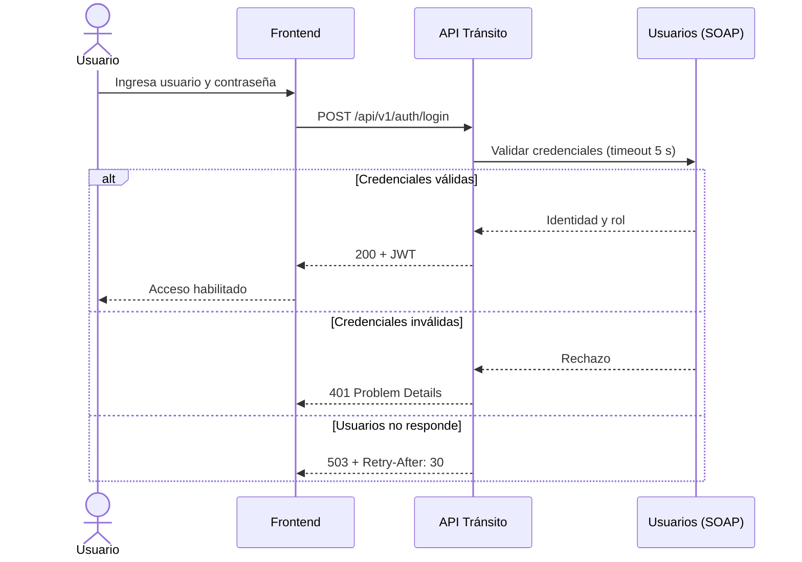
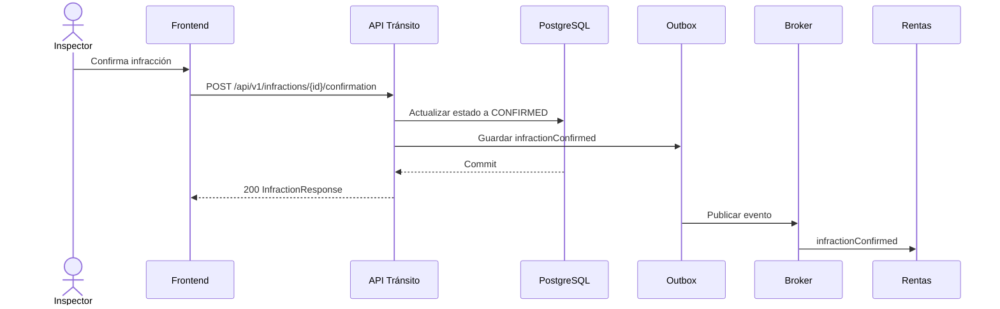

# UNIVERSIDAD ARGENTINA DE LA EMPRESA

## Facultad de Ingeniería y Ciencias Exactas

**Ingeniería en Informática**  
**Desarrollo de Aplicaciones II — Grupo 9**  
**Actividad API REST**

**Profesor:** Ruiz, Matías Gabriel

**Integrantes:**

- Abdala, Fernando — LU 1155644
- Abrego, Lautaro Elías — LU 1152414
- Fabian, Romina Betiana — LU 1168948
- García, Alejo — LU 1167615

---

## 1. Alcance de la entrega

Este documento presenta el contrato objetivo de la API REST del módulo de Tránsito, Estacionamiento y Seguridad Vial, junto con el estado actual de su implementación.

Actualmente están implementados los controladores REST, autenticación JWT mediante un proveedor de identidad local, autorización por roles, validación de titularidad en los recursos que cuentan con esa información, respuestas `application/problem+json`, versionado `/api/v1`, documentación Swagger/OpenAPI y el login integrado con el frontend.

La conexión SOAP con el módulo de Usuarios, la publicación en un broker, Transactional Outbox, idempotencia persistida, paginación e integración completa del frontend constituyen la evolución propuesta. Esta distinción permite mantener un contrato estable sin presentar como finalizadas funciones que todavía están en desarrollo.

## 2. Códigos HTTP generales

| Código | Significado |
|---|---|
| `200 OK` | Consulta o transición exitosa |
| `201 Created` | Recurso creado; incluye el encabezado `Location` |
| `204 No Content` | Baja lógica o eliminación exitosa |
| `400 Bad Request` | Solicitud inválida o JSON mal formado |
| `401 Unauthorized` | Token ausente, inválido o credenciales incorrectas |
| `403 Forbidden` | Usuario autenticado sin permisos |
| `404 Not Found` | Recurso inexistente |
| `409 Conflict` | Regla de negocio o transición de estado inválida |
| `429 Too Many Requests` | Límite de intentos de autenticación excedido — evolución propuesta |
| `502 Bad Gateway` | Respuesta inválida del servicio de identidad — evolución propuesta |
| `503 Service Unavailable` | Servicio de identidad no disponible — evolución propuesta |
| `500 Internal Server Error` | Error no controlado |

## 3. Convenciones del contrato

- URL base local: `http://localhost:8080`.
- Prefijo estable de la primera versión: `/api/v1`.
- Recursos expresados como sustantivos plurales.
- Transiciones expresadas como subrecursos nominales: `confirmation`, `annulment`, `closure`, etc.
- Autenticación mediante `Authorization: Bearer <jwt>`.
- Errores mediante `Content-Type: application/problem+json`.
- No se eliminan físicamente infracciones, accidentes, operativos ni retenciones porque forman parte del historial auditable.

## 4. Endpoints

### 4.1 Autenticación

| Método | URI | Acceso | Request | Respuesta |
|---|---|---|---|---|
| `POST` | `/api/v1/auth/login` | Público | `{username, password}` | `200 LoginResponse`; `400`, `401`; a futuro `429`, `502`, `503` |

### 4.2 Operativos

| Método | URI | Roles | Request | Respuesta |
|---|---|---|---|---|
| `POST` | `/api/v1/operations` | Inspector, operador | `CreateTrafficOperationRequest` | `201 TrafficOperationResponse` |
| `GET` | `/api/v1/operations` | Inspector, supervisor, auditor | Sin body | `200 TrafficOperationResponse[]` |
| `GET` | `/api/v1/operations/{id}` | Inspector, supervisor, auditor | UUID por path | `200`; `404` |
| `PATCH` | `/api/v1/operations/{id}` | Inspector | `UpdateTrafficOperationRequest` | `200`; `400`, `404`, `409` |
| `POST` | `/api/v1/operations/{id}/closure` | Inspector | `{resolution}` | `200`; `400`, `404`, `409` |

### 4.3 Infracciones

| Método | URI | Roles | Request | Respuesta |
|---|---|---|---|---|
| `POST` | `/api/v1/infractions` | Inspector | `CreateInfractionRequest` | `201 InfractionResponse` |
| `GET` | `/api/v1/infractions` | Inspector, supervisor, auditor | Sin body | `200 InfractionResponse[]` |
| `GET` | `/api/v1/infractions/mine` | Ciudadano | Sin body | `200 InfractionResponse[]` |
| `GET` | `/api/v1/infractions/{id}` | Inspector, auditor o ciudadano titular | UUID por path | `200`; `404` |
| `PATCH` | `/api/v1/infractions/{id}` | Inspector | `UpdateInfractionRequest` | `200`; `400`, `404`, `409` |
| `POST` | `/api/v1/infractions/{id}/appeal` | Ciudadano titular | `{reason}` | `200`; `400`, `404`, `409` |
| `POST` | `/api/v1/infractions/{id}/confirmation` | Inspector, supervisor | Sin body | `200`; `404`, `409` |
| `POST` | `/api/v1/infractions/{id}/annulment` | Supervisor | `{annulmentReason}` | `200`; `400`, `404`, `409` |

`inspectorId` y el responsable de la anulación se obtienen del JWT. No se aceptan desde el body.

### 4.4 Accidentes viales

| Método | URI | Roles | Request | Respuesta |
|---|---|---|---|---|
| `POST` | `/api/v1/accidents` | Inspector, operador | `CreateRoadAccidentRequest` | `201 RoadAccidentResponse` |
| `GET` | `/api/v1/accidents` | Inspector, supervisor, auditor | Sin body | `200 RoadAccidentResponse[]` |
| `GET` | `/api/v1/accidents/mine` | Ciudadano | Sin body (usa el DNI del token) | `200 RoadAccidentResponse[]` donde figura como persona o titular |
| `GET` | `/api/v1/accidents/{id}` | Inspector, supervisor, auditor | UUID por path | `200`; `404` |
| `PATCH` | `/api/v1/accidents/{id}` | Inspector | `UpdateRoadAccidentRequest` | `200`; `400`, `404`, `409` |

### 4.5 Vehículos retenidos

| Método | URI | Roles | Request | Respuesta |
|---|---|---|---|---|
| `POST` | `/api/v1/impoundments` | Inspector, personal de depósito | `CreateVehicleImpoundmentRequest` | `201 VehicleImpoundmentResponse` |
| `GET` | `/api/v1/impoundments` | Inspector, depósito, supervisor | Sin body | `200 VehicleImpoundmentResponse[]` |
| `GET` | `/api/v1/impoundments/mine` | Ciudadano | Sin body (usa el DNI del token) | `200 VehicleImpoundmentResponse[]` de vehículos propios |
| `GET` | `/api/v1/impoundments/{id}` | Inspector, depósito o ciudadano titular | UUID por path | `200`; `404` |
| `PATCH` | `/api/v1/impoundments/{id}` | Personal de depósito | `UpdateVehicleImpoundmentRequest` | `200`; `400`, `404`, `409` |
| `POST` | `/api/v1/impoundments/{id}/release` | Personal de depósito | `ReleaseImpoundmentRequest` | `200`; `400`, `404`, `409` |

### 4.6 Cortes de calle

Los cortes se crean al consumir un evento de Obras o Ambiente, por lo que no existe un endpoint público de creación.

| Método | URI | Roles | Request | Respuesta |
|---|---|---|---|---|
| `GET` | `/api/v1/street-closures` | Inspector, operador, supervisor | Sin body | `200 StreetClosureResponse[]` |
| `GET` | `/api/v1/street-closures/current` | **Público** | Sin body | `200 StreetClosureResponse[]` solo `APPROVED` y `ACTIVE` |
| `GET` | `/api/v1/street-closures/{id}` | Inspector, operador, supervisor | UUID por path | `200`; `404` |
| `POST` | `/api/v1/street-closures/{id}/approval` | Inspector, supervisor | `{detours, conditions}` | `200`; `400`, `404`, `409` |
| `POST` | `/api/v1/street-closures/{id}/rejection` | Inspector, supervisor | `{rejectionReason}` | `200`; `400`, `404`, `409` |
| `POST` | `/api/v1/street-closures/{id}/activation` | Operador | Sin body | `200`; `404`, `409` |
| `POST` | `/api/v1/street-closures/{id}/completion` | Operador | `{notes}` | `200`; `400`, `404`, `409` |

### 4.7 Zonas de estacionamiento

| Método | URI | Acceso | Request | Respuesta |
|---|---|---|---|---|
| `POST` | `/api/v1/parking-zones` | Administrador municipal | `CreateParkingZoneRequest` | `201 ParkingZoneResponse` |
| `GET` | `/api/v1/parking-zones` | Público | Sin body | `200 ParkingZoneResponse[]` |
| `GET` | `/api/v1/parking-zones/{id}` | Público | UUID por path | `200`; `404` |
| `PUT` | `/api/v1/parking-zones/{id}` | Administrador municipal | `UpdateParkingZoneRequest` | `200`; `400`, `404` |
| `DELETE` | `/api/v1/parking-zones/{id}` | Administrador municipal | UUID por path | `204`; `404` |

### 4.8 Tarifas

| Método | URI | Acceso | Request | Respuesta |
|---|---|---|---|---|
| `POST` | `/api/v1/parking-tariffs` | Administrador municipal | `CreateParkingTariffRequest` | `201 ParkingTariffResponse` |
| `GET` | `/api/v1/parking-tariffs?zoneId={uuid}` | Público | `zoneId` por query | `200 ParkingTariffResponse[]` |
| `GET` | `/api/v1/parking-tariffs/{id}` | Público | UUID por path | `200`; `404` |
| `PUT` | `/api/v1/parking-tariffs/{id}` | Administrador municipal | `UpdateParkingTariffRequest` | `200`; `400`, `404` |
| `DELETE` | `/api/v1/parking-tariffs/{id}` | Administrador municipal | UUID por path | `204`; `404`, `409` |

### 4.9 Sesiones de estacionamiento

| Método | URI | Roles | Request | Respuesta |
|---|---|---|---|---|
| `POST` | `/api/v1/parking-sessions` | Ciudadano, operador | `CreateParkingSessionRequest` | `201 ParkingSessionResponse` |
| `GET` | `/api/v1/parking-sessions` | Inspector, operador, supervisor | Sin body | `200 ParkingSessionResponse[]` |
| `GET` | `/api/v1/parking-sessions/{id}` | Inspector, ciudadano | UUID por path | `200`; `404` |
| `POST` | `/api/v1/parking-sessions/{id}/closure` | Ciudadano, operador | Sin body | `200`; `404`, `409` |
| `POST` | `/api/v1/parking-sessions/{id}/unpaid-flag` | Inspector | `{baseAmount}` | `200 InfractionResponse`; `400`, `404`, `409` |

## 5. Contrato OpenAPI

Se incluye un contrato OpenAPI 3.0.3 con diez operaciones representativas de autenticación, infracciones y operativos. El archivo fuente se encuentra en `src/main/resources/static/openapi.yaml`.

Con el backend levantado se publica en:

- Swagger UI: `http://localhost:8080/swagger-ui/index.html`
- Contrato estático: `http://localhost:8080/openapi.yaml`
- Especificación generada desde el código: `http://localhost:8080/v3/api-docs`

## 6. Ejemplos JSON

### Registro exitoso

```http
POST /api/v1/infractions HTTP/1.1
Authorization: Bearer <jwt>
Content-Type: application/json
```

```json
{
  "licensePlate": "AB123CD",
  "infractionType": "ILLEGAL_PARKING",
  "infractionDateTime": "2026-10-06T14:30:00",
  "location": {
    "street": "Av. Cabildo",
    "crossStreet": "Juramento",
    "latitude": -34.5621,
    "longitude": -58.4563
  },
  "evidenceUrl": ["https://evidencias.uade.edu.ar/infractions/foto-123.jpg"],
  "offenderNationalId": "40123456",
  "debtorId": "40123456",
  "debtorIdType": "DNI",
  "baseAmount": 50000,
  "aggravatingFactors": ["REINCIDENCE"],
  "finalAmount": 75000,
  "originOperationId": "d06b75bf-b2fe-4318-93a2-d2e22320fa83"
}
```

Respuesta:

```http
HTTP/1.1 201 Created
Location: /api/v1/infractions/93fd4382-2343-4f3f-a127-9328b29fc520
Content-Type: application/json
```

El backend incorpora `infractionId`, `inspectorId` y `status: "PENDING_APPEAL"` en la respuesta.

### Error mediante Problem Details

```http
HTTP/1.1 409 Conflict
Content-Type: application/problem+json
```

```json
{
  "type": "https://transito.uade.edu.ar/problems/invalid-state-transition",
  "title": "Conflict",
  "status": 409,
  "detail": "No se puede confirmar una infracción en estado ANNULLED",
  "instance": "/api/v1/infractions/93fd4382-2343-4f3f-a127-9328b29fc520/confirmation"
}
```

## 7. Diagramas de secuencia

### 7.1 Autenticación objetivo



Actualmente `Usuarios (SOAP)` está reemplazado por un proveedor local detrás de la interfaz `IdentityValidator`.

### 7.2 Confirmación de una infracción — arquitectura objetivo



Actualmente los eventos se publican mediante `LoggingEventPublisher`; broker y Outbox quedan como evolución.

## 8. Decisiones justificadas

### Versionado

Se utiliza `/api/v1` porque el versionado por URI es visible en documentación y logs, simplifica el enrutamiento y permite mantener versiones incompatibles durante una migración.

### Seguridad

La implementación utiliza Spring Security, JWT, sesiones stateless, autorización por roles, CORS configurable y secretos mediante variables de entorno. El token tiene una duración de dos horas.

Roles definidos: `INSPECTOR`, `SUPERVISOR`, `AUDITOR`, `OPERADOR_CONTROL`, `PERSONAL_DEPOSITO`, `ADMIN_MUNICIPAL` y `CIUDADANO`.

### Idempotencia — evolución propuesta

Las consultas, reemplazos y eliminaciones son idempotentes. Las transiciones verifican el estado actual y devuelven `409` cuando no pueden repetirse. Para las creaciones se propone aceptar `Idempotency-Key`, conservando la clave y la respuesta durante 24 horas.

### Comunicación asíncrona — evolución propuesta

La confirmación de una infracción no debe esperar a que Rentas cree la deuda. Se propone publicar `infractionConfirmed` mediante un broker y utilizar Transactional Outbox para persistir el cambio de estado y el evento en una misma transacción.

### Indisponibilidad del servicio de Usuarios — evolución propuesta

La llamada de autenticación tendrá un timeout de cinco segundos. Si el servicio no responde, no se generará el JWT y se devolverá `503 Service Unavailable`, `application/problem+json` y `Retry-After: 30`.

## 9. Estado del frontend

El frontend implementa el login real contra `/api/v1/auth/login`, almacenamiento de la sesión, envío automático del JWT y lectura de Problem Details. El resto de las pantallas constituye un prototipo navegable con datos mock. La integración de cada módulo con los endpoints REST es la siguiente etapa del proyecto.

## 10. Hoja de ruta

- [ ] Reemplazar el proveedor local de identidad por el cliente SOAP.
- [ ] Implementar timeout, `429`, `502`, `503` y `Retry-After` para autenticación.
- [ ] Incorporar paginación, filtros, orden y enlaces hipermedia en infracciones.
- [ ] Normalizar las fechas de dominio con zona horaria.
- [ ] Implementar `Idempotency-Key` con persistencia y vencimiento.
- [ ] Incorporar broker y Transactional Outbox.
- [ ] Conectar las pantallas restantes del frontend con la API.
- [ ] Añadir pruebas de contrato, autorización, titularidad y transiciones de estado.

## 11. Respuesta a la pregunta clave

En la arquitectura objetivo, si el servicio legado de Usuarios no responde dentro de cinco segundos, la API devolverá `503 Service Unavailable`, `Content-Type: application/problem+json` y `Retry-After: 30`. No se generará el token y el usuario deberá reintentar cuando el servicio vuelva a estar disponible.
