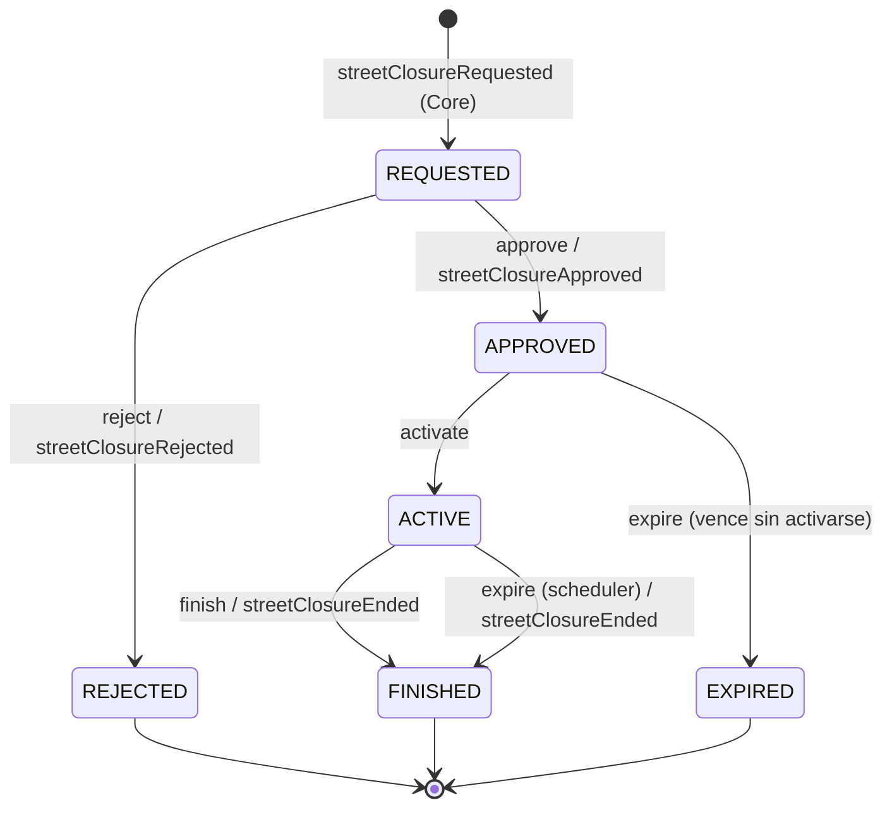
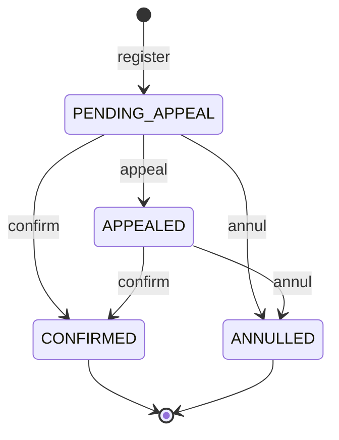

# Patrón State — ciclo de vida de cortes de calle e infracciones (DEF-13)

**Dónde:** `model/state/`. **Tests:** `model/state/StreetClosureStateTest` e `InfractionStateTest` (matriz completa estado × operación).

## Diseño

- `StreetClosureState` (interfaz) declara `approve`, `reject`, `activate`, `finish` y `expire` (cierre automático por vencimiento). Cada operación, **por defecto, lanza `InvalidStateTransitionException`** → `GlobalExceptionHandler` responde **409 Problem Details** (mismo formato y mensaje que antes).
- Una clase por estado (`RequestedState`, `ApprovedState`, `ActiveState`, `RejectedState`, `FinishedState`, `ExpiredState`) sobrescribe solo las transiciones que admite y devuelve el estado siguiente. No hay `switch`/`if` sobre el enum en el servicio.
- `StreetClosureStates.of(status)` resuelve el objeto estado desde el enum persistido. **La columna `status` y el enum `StreetClosureStatus` no cambian** (sin migración).
- `StreetClosureService` delega: `StreetClosureStates.of(c).approve(c)` → guarda → publica el evento. Eventos, `correlationId`/`causationId` y contratos REST quedan idénticos.
- Lo mismo para `Infraction` (`InfractionState`: `appeal`, `confirm`, `annul`, `requireEditable`).

## Corte de calle

Cualquier otra combinación (24 de 30) → 409. Ejemplo: `POST /api/v1/street-closures/{id}/activation` sobre un corte `REQUESTED` → 409 con `detail` "… debe estar en estado APPROVED (actual: REQUESTED)".

## Infracción

Edición de datos solo en `PENDING_APPEAL`/`APPEALED`; en estados firmes → 409.
